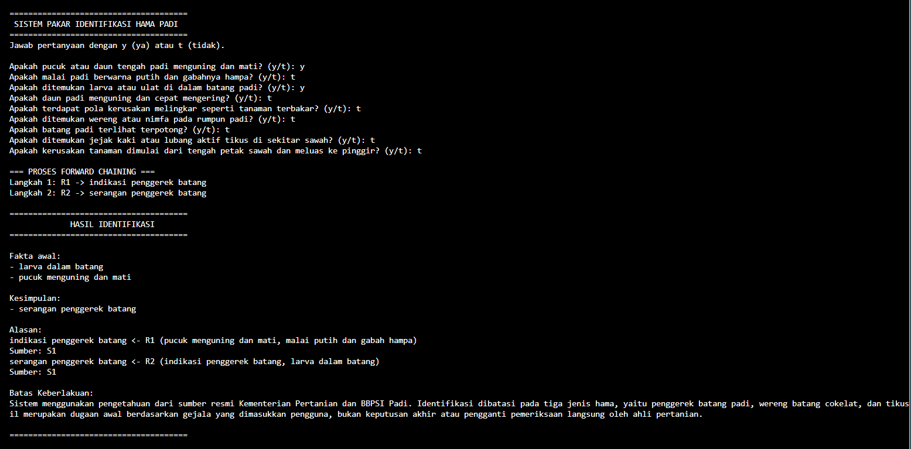
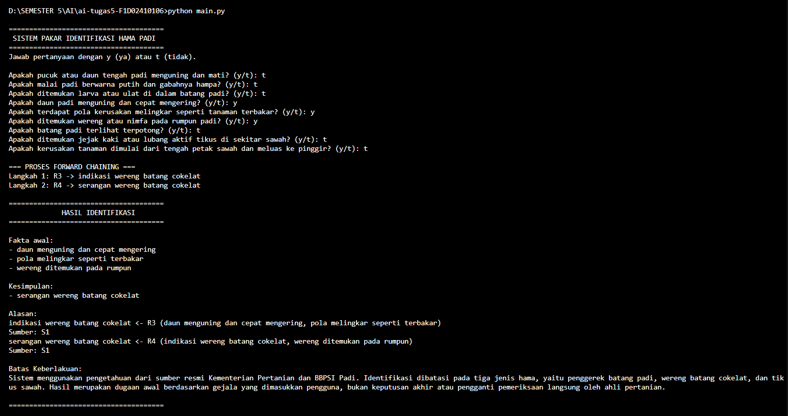
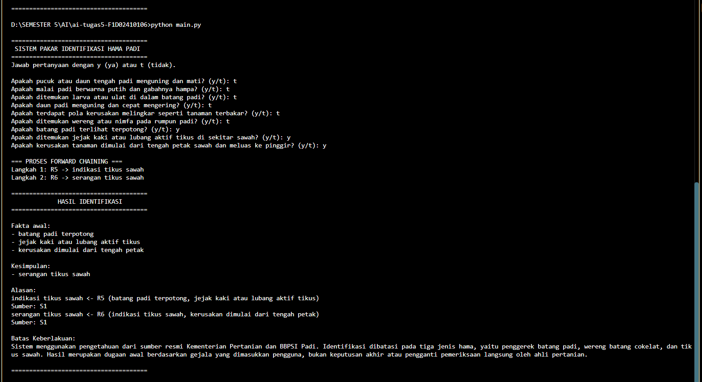
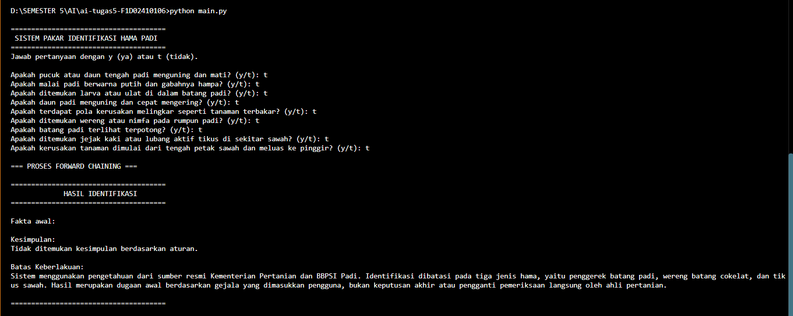

# Sistem Pakar Identifikasi Hama Tanaman Padi

- Nama: Annisa Makarima Ahlaq
- NIM: F1D02410106
- Mata Kuliah: Kecerdasan Buatan
- Tugas: Materi 5 - Membuat Sistem Pakar Sederhana

## Deskripsi
Program ini membantu mengidentifikasi kemungkinan serangan hama berdasarkan gejala yang dialami tanaman padi. Pengguna menjawab pertanyaan dengan y (ya) atau t (tidak), kemudian sistem mencocokkan jawaban tersebut dengan aturan yang tersedia.

Tiga jenis hama yang dapat diidentifikasi:

1. Penggerek batang padi, dengan gejala seperti pucuk atau daun tengah menguning dan mati, malai berwarna putih, serta gabah hampa.
2. Wereng batang cokelat, dengan gejala daun menguning, mengering seperti terbakar, pola kerusakan melingkar, dan ditemukannya wereng pada rumpun padi.
3. Tikus sawah, dengan gejala batang padi terpotong, ditemukan jejak kaki atau lubang aktif tikus, serta kerusakan yang dimulai dari tengah petak sawah.

Sistem digunakan untuk mengidentifikasi kemungkinan satu jenis serangan berdasarkan gejala yang dimasukkan pengguna. Hasil identifikasi merupakan dugaan awal dan bukan pengganti pemeriksaan langsung oleh ahli pertanian.

Sistem menggunakan metode Forward Chaining untuk mengolah fakta dan mencocokkannya dengan aturan IF-THEN sehingga menghasilkan kesimpulan.

- Bahasa pemrograman: Python
- Basis pengetahuan: JSON
- Metode inferensi: Forward Chaining

## Struktur Folder

ai-tugas5-NIM/
│
├── main.py
├── knowledge_base.json
├── README.md
└── screenshot/
    ├── kasus1_penggerek_batang.png
    ├── kasus2_wereng.png
    ├── kasus3_tikus.png
    └── kasus4_tidak_ditemukan.png

## Cara Menjalankan Program

Buka terminal pada folder proyek, kemudian jalankan:

python main.py

Program akan menampilkan sembilan pertanyaan mengenai gejala serangan hama padi. Jawab setiap pertanyaan menggunakan:

-y untuk ya.
-t untuk tidak.

Setelah seluruh pertanyaan dijawab, program menjalankan proses Forward Chaining dan menampilkan fakta awal, aturan yang terpenuhi, kesimpulan identifikasi, alasan, sumber aturan, serta batas keberlakuan sistem.

## Sumber Pengetahuan

**S1. Pengendalian Penggerek Batang Padi**

- Penerbit: Balai Pengkajian Teknologi Pertanian Gorontalo, Kementerian Pertanian.
- Tahun: 2016.
- Bagian yang digunakan: Gejala serangan penggerek batang padi, termasuk sundep (kematian anakan muda) dan beluk (malai putih dan hampa).
- URL: https://repository.pertanian.go.id/handle/123456789/21821

**S2. Info Teknologi: Pengendalian Wereng Batang Coklat pada Padi**

- Penerbit: Pusat Perpustakaan dan Literasi Pertanian, Kementerian Pertanian.
- Tanggal publikasi: 25 Maret 2023.
- Bagian yang digunakan: Gejala serangan wereng batang cokelat, yaitu tanaman menguning dan mengering seperti terbakar serta pola kerusakan melingkar (*hopperburn*).
- URL: https://pustaka.bppsdmp.pertanian.go.id/info-literasi/pengendalian-wereng-batang-coklat-pada-padi

**S3. Informasi Ringkas Teknologi Padi – Tikus**

- Penerbit: Repositori Kementerian Pertanian.
- Bagian yang digunakan: Karakteristik serangan tikus sawah, keberadaan jejak kaki, jalur larian, kotoran, lubang aktif, serta kerusakan yang dimulai dari tengah petak dan meluas ke pinggir.
- URL: https://repository.pertanian.go.id/bitstreams/82141b7c-8fdc-4772-8859-9a647f67c9d3/download

## Aturan IF-THEN
Basis pengetahuan disimpan dalam file knowledge_base.json yang berisi sembilan pertanyaan, enam aturan IF-THEN, tiga kesimpulan utama, dan informasi sumber pengetahuan.

| ID | Kondisi IF | Kesimpulan THEN |
|---|---|---|
| R1 | Pucuk menguning dan mati OR malai putih dan gabah hampa | Indikasi penggerek batang |
| R2 | Indikasi penggerek batang AND larva dalam batang | Serangan penggerek batang |
| R3 | Daun menguning dan cepat mengering AND pola melingkar seperti terbakar | Indikasi wereng batang cokelat |
| R4 | Indikasi wereng batang cokelat AND wereng ditemukan pada rumpun | Serangan wereng batang cokelat |
| R5 | Batang padi terpotong AND jejak kaki atau lubang aktif tikus | Indikasi tikus sawah |
| R6 | Indikasi tikus sawah AND kerusakan dimulai dari tengah petak | Serangan tikus sawah |

Aturan yang menggunakan hasil aturan sebelumnya membentuk rantai inferensi:

- R2 menggunakan hasil R1.
- R4 menggunakan hasil R3.
- R6 menggunakan hasil R5.

Dengan demikian, sistem tidak hanya mencocokkan gejala secara langsung, tetapi juga menggunakan kesimpulan sementara sebagai fakta untuk menjalankan aturan berikutnya.

## Metode Forward Chaining

Forward Chaining dipilih karena pengguna memulai konsultasi dengan memasukkan fakta berupa gejala yang ditemukan pada tanaman padi. Fakta tersebut kemudian diproses untuk memperoleh kesimpulan mengenai kemungkinan hama yang menyerang. Forward Chaining merupakan metode inferensi yang dimulai dari fakta awal untuk menghasilkan fakta baru berdasarkan aturan IF-THEN.

### Langkah-langkah
1. Program membaca basis pengetahuan dari file `knowledge_base.json`.
2. Program menampilkan pertanyaan mengenai gejala hama padi.
3. Jawaban `y` disimpan sebagai fakta awal, sedangkan jawaban `t` tidak dimasukkan ke dalam memori kerja.
4. Program memeriksa setiap aturan berdasarkan fakta yang tersedia. Kondisi `dan` terpenuhi jika seluruh premis sesuai, sedangkan kondisi `atau` terpenuhi jika minimal satu premis sesuai.
5. Jika suatu aturan terpenuhi, hasilnya ditambahkan ke memori kerja dan dicatat dalam riwayat inferensi.
6. Proses pemeriksaan diulang sampai tidak ditemukan aturan baru yang dapat dijalankan.
7. Program menampilkan kesimpulan akhir, aturan yang aktif, alasan penalaran, sumber pengetahuan, dan batas keberlakuan sistem.

### Contoh Proses
Fakta:
- Pucuk menguning dan mati.
- Larva ditemukan dalam batang.

Proses:
- R1 menghasilkan indikasi penggerek batang.
- R2 menghasilkan serangan penggerek batang.

Kesimpulan:
Serangan penggerek batang.

## Pengujian Program

### Kasus 1 - Penggerek Batang Padi

### Kasus 2 - Wereng Batang Cokelat

### Kasus 3 - Tikus Sawah

### Kasus 4 - Tidak Ditemukan Kesimpulan

### Hasil Kasus 1: Penggerek Batang Padi

Pengujian dilakukan dengan memasukkan gejala pucuk menguning dan mati serta ditemukannya larva dalam batang.

Hasil yang diharapkan adalah kesimpulan serangan penggerek batang padi melalui aturan R1 dan R2.

### Hasil Kasus 2: Wereng Batang Cokelat

Pengujian dilakukan dengan memasukkan gejala daun menguning dan mengering, pola kerusakan melingkar seperti terbakar, serta ditemukannya wereng pada rumpun padi.

Hasil yang diharapkan adalah kesimpulan serangan wereng batang cokelat melalui aturan R3 dan R4.

### Hasil Kasus 3: Tikus Sawah

Pengujian dilakukan dengan memasukkan gejala batang padi terpotong, ditemukan jejak kaki atau lubang aktif tikus, serta kerusakan yang dimulai dari tengah petak sawah.

Hasil yang diharapkan adalah kesimpulan serangan tikus sawah melalui aturan R5 dan R6.

### Hasil Kasus 4: Tidak Ditemukan Kesimpulan

Pengujian dilakukan dengan menjawab seluruh pertanyaan menggunakan `t` (tidak).

Hasil yang diharapkan adalah sistem tidak menemukan kesimpulan karena tidak ada fakta awal yang memenuhi aturan IF-THEN.

## Batas Keberlakuan

Sistem ini menggunakan pengetahuan dari Kementerian Pertanian dan Balai Besar Pengujian Standar Instrumen Padi (BBPSI Padi). Identifikasi dibatasi pada tiga jenis hama, yaitu penggerek batang padi, wereng batang cokelat, dan tikus sawah berdasarkan gejala yang tersedia dalam basis pengetahuan. Sistem digunakan sebagai identifikasi awal dan sarana pembelajaran. Kesimpulan yang dihasilkan merupakan dugaan berdasarkan aturan, bukan keputusan akhir atau pengganti pemeriksaan langsung oleh ahli pertanian.

## Penggunaan AI

Dalam pengerjaan proyek ini, AI digunakan sebagai alat bantu pada beberapa tahap, yaitu:

1. **Membantu pencarian dan pemahaman sumber.** AI membantu menelaah informasi dari publikasi resmi mengenai gejala dan karakteristik serangan hama pada tanaman padi.
2. **Membantu penyusunan basis pengetahuan.** AI membantu menyusun pertanyaan, fakta, aturan IF-THEN, kesimpulan, dan struktur file `knowledge_base.json`.
3. **Membantu penyusunan program.** AI membantu menyusun dan menjelaskan kode Python, termasuk pembacaan JSON, penerapan Forward Chaining, memori kerja, dan riwayat inferensi.
4. **Membantu dokumentasi.** AI membantu menyusun kerangka dan penjelasan pada file `README.md`, termasuk cara menjalankan program dan skenario pengujian.

AI digunakan sebagai alat bantu, bukan sebagai pengganti sumber referensi. Penulis tetap bertanggung jawab untuk memahami, memeriksa, dan menguji aturan serta kode program yang digunakan.
